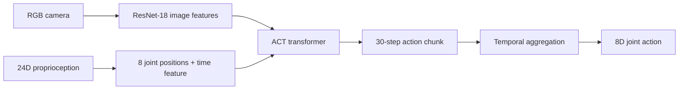

# ATEC Task E · RGB and joint-state ACT policy

> **Publication status:** Inference code and a verified success video are public. Model weights and demonstration data are not included. Running inference requires a compatible local checkpoint and a prepared Task E environment.

An inference-focused robotics project for the ATEC Task E tabletop scene. A Piper arm must place a sugar box, mustard bottle, and banana into a bin. This repository shows the policy interface, model architecture, and a local checkpoint adapter that can be inspected in a prepared Task E environment.

> 中文简介：这是 ATEC Task E 三物体搬运任务的 ACT 推理展示版，重点呈现专家控制调试、标准观测接口和闭环评测中的工程取舍。

## Successful rollout video

[Watch the complete seed 100 ACT rollout (MP4, 61 s)](demo/task_e_seed100_success.mp4). The simulator run ended with **18/18** and `basket_success`. The video is cropped to keep the tabletop visible; no task state, terminal, or training data is overlaid. Seed 100 appeared in the demonstrations, so this shows a reproduced success, not unseen-scene generalization.

## What I built

- Repaired and checked an expert controller across all three objects, including side approach and vertical lift behavior for the mustard bottle.
- Connected a camera and joint-state ACT policy to the task's `AlgSolution.predicts(obs, current_score)` interface. Inference reads `obs["image"]["video_rgb"]` and `obs["proprio"]`; it does not use simulator object poses.
- Added a deterministic startup/home phase, relative-to-absolute joint conversion, a time feature, 30-step action chunks, and temporal aggregation before emitting the 8-dimensional environment action.
- Diagnosed the main closed-loop failure mode: a small positioning error near the mustard bottle can leave the gripper short of the object, and that state error can block the later banana stage. This is why open-loop action error alone is insufficient to judge the task.



## Evidence and limits

| Check | Result | Interpretation |
| --- | --- | --- |
| Local Task E evaluation, seed 100 | 18/18, `basket_success` in a recorded run | Seed 100 was represented in the demonstrations. This is a reproduction case, not a held-out success rate. |
| Packaged inference smoke test | 1 × 8 finite action from RGB + proprioception | Checks model loading and the public interface; it does not check manipulation. |
| Generalization | Not established | Other placements can fail at the mustard stage. No multi-seed success claim is made. |

Model weights are intentionally kept local. The public video records one complete in-distribution rollout; the repository does not provide a downloadable policy checkpoint.

## Run the demo

### 1. Check the inference interface

Use a CUDA-enabled Python environment with compatible PyTorch, torchvision, and NumPy versions. In a Task E Isaac Lab environment, use the versions already paired with Isaac Sim.

```powershell
python examples\inference_smoke.py --checkpoint .\local_checkpoint.pt
```

Expected output ends with `PASS: observation -> (1, 8) finite action`. The script uses a synthetic black image; it is a package check, not a task score. Supply your own compatible local checkpoint with `--checkpoint`.

### 2. Run in the simulator

The ATEC Task E simulator and robot/scene assets are not redistributed here. Place this repository's `demo/` directory at the root of a prepared Task E checkout that provides `scripts/play_atec_task.py` and the `ATEC-TaskE-Piper` task, and provide a local checkpoint file. From that checkout, run:

```powershell
conda activate atec_task_e
$env:PYTHONPATH="$PWD\source\atec_rl_lab;$PWD"
python scripts\play_atec_task.py --task ATEC-TaskE-Piper --num_envs 1 --enable_cameras --seed 100 --checkpoint .\local_checkpoint.pt
```

The score is printed by the simulator after the episode. The checkpoint path can also be supplied through `ATEC_TASK_E_POLICY`. A CUDA GPU and RGB camera observation are required by this policy.

For a short presentation sequence and honest result framing, see the [interview demo guide](docs/DEMO_GUIDE.md).

## Repository contents

```text
demo/solution.py             Task E submission entry point
demo/solution_act.py         observation adapter, startup/home logic, ACT inference
demo/act/                   model and time-feature code needed for inference
examples/inference_smoke.py  package-level interface check
demo/task_e_seed100_success.mp4  verified complete rollout video
LICENSE                      ATEC MIT notice
```

## Attribution and data handling

This work builds on the [ATEC 2026 Simulation Challenge](https://github.com/atecup/ATEC2026_Simulation_Challenge) and its MIT-licensed Task E handoff code. The ACT/DETR model components retain upstream copyright notices where present. The challenge's simulator assets remain in the original project. This public repository intentionally excludes demonstration trajectories, training instructions, evaluation traces, local machine paths, and private data.

